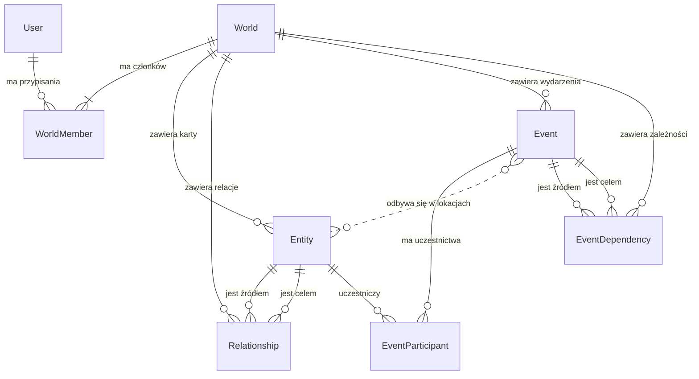

# ARCHITECTURE.md — WorldGraph

> Dokument planowanej architektury aplikacji. Dostępny jest statyczny szablon strony startowej i lokalne środowisko Docker Compose; kod backendu nie został jeszcze rozpoczęty.

## Zakładany stos
- PHP (backend obiektowy), PostgreSQL, HTML/CSS, JavaScript.
- Lokalne środowisko Docker Compose: Nginx → PHP 8.5-FPM (`pdo_pgsql`) → PostgreSQL 18.
- Biblioteka grafowa JS do wyboru podczas implementacji.

## Planowany przepływ
`Browser → Router → Controller → Service → Repository → PostgreSQL`

- `Controller`: przyjmowanie żądań HTTP i odpowiedzi.
- `Service`: przypadki użycia i autoryzacja operacji.
- `Repository`: pobieranie i zapisywanie danych.
- `Domain`: zasady dotyczące światów, encji, relacji, chronologii i spójności.
- `templates`: widoki HTML.
- `public/assets`: statyczne pliki frontendu.

## Planowany model pojęciowy

Ustalenia punktu 0.6 TODO opisują znaczenie danych, ich powiązania i podstawowe zasady. Są podstawą późniejszego projektu bazy i klas; nie stanowią jeszcze schematu SQL ani implementacji backendu.

### Pojęcia

| Pojęcie | Znaczenie i powiązania |
|---|---|
| `User` | Konto osoby korzystającej z aplikacji. Może należeć do wielu światów, z inną rolą w każdym z nich. Nie jest postacią fabularną. |
| `World` | Jeden projekt fikcyjnego świata: jego wprowadzenie, widoczność oraz własne karty, relacje i wydarzenia. Jest granicą dostępu i izolacji danych. |
| `WorldMember` | Przypisanie istniejącego użytkownika do konkretnego świata z jedną rolą: `owner` (właściciel), `editor` (redaktor) albo `reader` (czytelnik). |
| `Entity` | Jedna karta elementu świata, określonego typu: postać, lokacja, frakcja, rasa/gatunek lub artefakt. Ta sama karta może występować w wielu relacjach, wydarzeniach i widokach. |
| `Relationship` | Opisane powiązanie dokładnie dwóch kart tego samego świata. Typ określa znaczenie powiązania; szczegółowe zasady kierunku i wzajemności należą do 0.8 i etapu 6. |
| `Event` | Wydarzenie świata, odrębne od karty, z opisem, statusem opracowania i informacją o czasie. Może mieć uczestników, miejsca i zależności względem innych wydarzeń. |
| `EventParticipant` | Uczestnictwo łączące jedno wydarzenie z jedną istniejącą kartą oraz opisujące jej rolę w wydarzeniu. Rola uczestnika fabuły jest niezależna od roli użytkownika w `WorldMember`. |
| `EventDependency` | Zależność łącząca dwa wydarzenia tego samego świata: źródłowe i docelowe. Jest podstawą grafu wydarzeń; znaczenia zależności, np. następstwo lub przyczyna, zostaną doprecyzowane w etapie 9. |

Nazwy powiązań `EventParticipant` i `EventDependency` służą tutaj opisowi pojęć. Nie przesądzają jeszcze liczby tabel ani klas PHP.

### Własność i członkostwo

- Dla pary użytkownik–świat istnieje najwyżej jedno `WorldMember`, z jedną rolą. Ten sam użytkownik może być właścicielem jednego świata, redaktorem drugiego i czytelnikiem trzeciego.
- Każdy istniejący świat ma dokładnie jednego członka z rolą `owner`. Przy utworzeniu świata tę rolę otrzymuje jego twórca. Właściciel jest wskazywany przez `WorldMember`; nie utrzymujemy drugiego, niezależnego przypisania właściciela w `World`.
- Świat nie może pozostać bez właściciela ani mieć dwóch właścicieli. Funkcja przekazywania własności nie jest dodawana w ramach tych ustaleń.
- Gość nie potrzebuje konta ani członkostwa do odczytu publicznego świata. Tak samo zalogowany użytkownik bez członkostwa może przeglądać publiczny świat; nie tworzy to automatycznie `WorldMember` ani prawa edycji.
- Nowy świat jest prywatny. Publikacja dotyczy całego świata i nie zmienia ról jego członków. Szczegółowa macierz dozwolonych operacji należy do 0.7.

### Powiązania i liczności

`||` oznacza dokładnie jeden element, `o{` oznacza od zera do wielu, a `|{` — co najmniej jeden. Diagram pokazuje powiązania pojęciowe; dokładnie jednego właściciela i ograniczenia typów opisują dodatkowo zasady tekstowe.

- Świat może jeszcze nie mieć kart, relacji ani wydarzeń, ale zawsze ma właściciela. Każda karta, relacja, wydarzenie i zależność wydarzeń należy do dokładnie jednego świata.
- Wydarzenie może być szkicem bez uczestników, znanego miejsca lub daty. Jedna karta może uczestniczyć w wielu wydarzeniach; jedno wydarzenie może mieć wiele kart uczestników. Dla pary wydarzenie–karta istnieje najwyżej jedno uczestnictwo opisujące rolę tego elementu.
- Uczestnikiem może być karta dowolnego z zatwierdzonych typów, jeżeli autor opisuje jej udział lub znaczenie w wydarzeniu. Nie oznacza to, że każda powiązana lokacja automatycznie staje się uczestnikiem.
- Miejsce wydarzenia jest osobnym powiązaniem z kartą typu lokacja. Wydarzenie może mieć zero lub więcej miejsc, a lokacja może być miejscem wielu wydarzeń. Miejsce i uczestnictwo mają różne znaczenie, nawet gdy wskazują tę samą kartę. Diagram nie przesądza technicznego sposobu zapisu miejsc.

### Izolacja i wspólne dane

- Oba końce `Relationship` muszą wskazywać istniejące karty świata, do którego należy relacja.
- Karta uczestnika i każda lokacja wydarzenia muszą należeć do świata tego wydarzenia. Świat uczestnictwa wynika z powiązanego wydarzenia; nie można użyć uczestnictwa do połączenia odizolowanych światów.
- Oba końce `EventDependency` muszą wskazywać istniejące wydarzenia świata, do którego należy zależność.
- Konto użytkownika nie jest automatycznie łączone z kartą postaci. Udział postaci w fabule nie nadaje nikomu dostępu do projektu.
- Lista, szczegóły i graf korzystają z tych samych kart, relacji, wydarzeń i ich powiązań. Widok grafu nie tworzy osobnej kopii karty ani wydarzenia. `CURRENT_EVENT` oznacza opracowywane `Event` i jego status, bez osobnego obiektu bieżącego wydarzenia lub systemu wersjonowania.
- Weryfikacja świata i uprawnień odbywa się po stronie serwera także przy bezpośrednim żądaniu, a nie tylko podczas budowania interfejsu.

### Powiązanie z widokami MYRA i zakresem MVP

| Widok | Dane modelu pojęciowego |
|---|---|
| Relacje — `RELETIONSHIPS_GRAPH` | Istniejące karty i opisane powiązania między nimi. |
| Lokacje — `LOCATIONES_GRAPH` | Karty lokacji i ich powiązania, bez osobnych kopii kart i bez pełnej mapy przestrzennej. |
| Los — `FATE_GRAPH` | Istniejące karty postaci oraz kierunkowy wpływ jednej postaci na inne postacie i ich działania. Należy do podstawowego MVP i etapu 7. Sposób zapisu wpływu — w ramach relacji lub osobno — oraz ewentualne miary pozostają do ustalenia w 0.8. |
| Wydarzenia — `EVENTE_GRAPH` | Istniejące wydarzenia i ich zależności, wspólne z listą wydarzeń i chronologią. Należy do podstawowego MVP i etapu 9. |

Kontrola spójności jest osobnym modułem extended MVP z etapu 10, analizującym już zapisane dane świata. Przyszłe `ConsistencyIssue` oznacza wyjaśnione ostrzeżenie z odniesieniami do analizowanych danych i możliwością uzasadnienia przez autora. Nie należy do podstawowego modelu wdrażanego w etapach 1–9; w tym zakresie zakładka Spójność pozostaje TBI. `FATE_GRAPH` opisuje wpływ postaci i nie jest kontrolą spójności.

### Granice ustaleń 0.6

- 0.7: pełna macierz uprawnień gościa, właściciela, redaktora i czytelnika.
- 0.8: szczegółowe pola kart, początkowe typy i reguły relacji, sposób zapisu wpływu oraz zasady usuwania powiązanych danych.
- Etap 9: szczegóły uczestników, miejsc i zależności wydarzeń; w 9.1 model czasu fikcyjnego, brakujących i niepewnych dat oraz ich porównywania, bez domyślnego kalendarza gregoriańskiego.
- Etapy implementacji: klasy, repozytoria, migracje, ograniczenia bazy i testy egzekwujące opisane zasady. Diagram pojęciowy nie oznacza jeszcze ukończenia kryterium ERD dla rzeczywistej bazy.

Ukończenie 0.6 oznacza zapisanie i sprawdzenie tych definicji, powiązań, liczności i zasad. Nie oznacza utworzenia bazy ani działających modułów aplikacji.

## Zasady projektowe
- Warunek zaliczenia: rzeczywiście obiektowy backend.
- Dostęp do światów sprawdza serwer, a nie tylko interfejs.
- Relacje nie mogą łączyć encji z różnych światów.
- Daty fikcyjnych światów nie powinny być uzależnione od systemowego `timestamp`.
- Na mobile graf powinien mieć alternatywną listę relacji.

## Status
Konfiguracja kontenerów znajduje się w `compose.yaml` i `docker/`; instrukcja uruchomienia jest w `README.md`. `public/index.html` i `public/assets/css/style.css` tworzą responsywny szablon strony startowej z przykładowym grafem SVG. Nie ma jeszcze klas backendu, API, SQL ani schematu bazy aplikacji.
