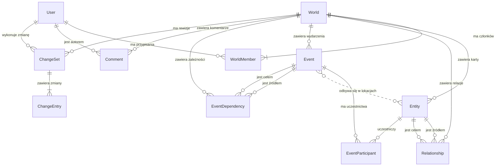

# ARCHITECTURE.md — WorldGraph

> Dokument planowanej architektury aplikacji. Dostępny jest statyczny szablon strony startowej i lokalne środowisko Docker Compose; kod backendu nie został jeszcze rozpoczęty.

## Zakładany stos
- PHP (backend obiektowy), PostgreSQL, HTML/CSS, JavaScript.
- Lokalne środowisko Docker Compose: Nginx → PHP 8.5-FPM (`pdo_pgsql`) → PostgreSQL 18.
- Biblioteka grafowa JS do wyboru podczas implementacji.

## Planowany przepływ
`Browser → Router → Controller → Service → Repository → PostgreSQL`

- `Controller`: przyjmowanie żądań HTTP i odpowiedzi.
- `Service`: przypadki użycia i autoryzacja operacji.
- `Repository`: pobieranie i zapisywanie danych.
- `Domain`: zasady dotyczące światów, encji, relacji, chronologii i spójności.
- `templates`: widoki HTML.
- `public/assets`: statyczne pliki frontendu.

## Planowany model pojęciowy

Ustalenia punktu 0.6 TODO opisują znaczenie danych, ich powiązania i podstawowe zasady. Punkt 0.7 aktualizuje model o zatwierdzone role, trzy poziomy prywatności, komentarze i historię zmian w podstawowym MVP. Jest to podstawa późniejszego projektu bazy i klas; nie stanowi jeszcze schematu SQL ani implementacji backendu. Kanoniczna macierz ról i katalog uprawnień znajdują się w [PROJECT.md — Role, prywatność i uprawnienia](PROJECT.md#role-prywatność-i-uprawnienia--ustalenia-07).

### Pojęcia

| Pojęcie | Znaczenie i powiązania |
|---|---|
| `User` | Konto osoby korzystającej z aplikacji. Może należeć do wielu światów, z inną rolą w każdym z nich. Nie jest postacią fabularną. |
| `World` | Jeden projekt fikcyjnego świata: jego wprowadzenie, prywatność (`private`, `restricted`, `public`) oraz własne karty, relacje, wydarzenia, komentarze i historia zmian. Jest granicą dostępu i izolacji danych. |
| `WorldMember` | Przypisanie istniejącego użytkownika do konkretnego świata z jedną rolą: `creator` (Twórca), `owner` (Właściciel), `editor` (Redaktor), `reader` (Czytelnik) albo `custom` (indywidualny zestaw uprawnień). Gość nie jest przypisaną rolą członkowską. |
| `Entity` | Jedna karta elementu świata, określonego typu: postać, lokacja, frakcja, rasa/gatunek lub artefakt. Ta sama karta może występować w wielu relacjach, wydarzeniach i widokach. |
| `Relationship` | Opisane powiązanie dokładnie dwóch kart tego samego świata. Typ określa znaczenie powiązania; szczegółowe zasady kierunku i wzajemności należą do 0.8 i etapu 6. |
| `Event` | Wydarzenie świata, odrębne od karty, z opisem, statusem opracowania i informacją o czasie. Może mieć uczestników, miejsca i zależności względem innych wydarzeń. |
| `EventParticipant` | Uczestnictwo łączące jedno wydarzenie z jedną istniejącą kartą oraz opisujące jej rolę w wydarzeniu. Rola uczestnika fabuły jest niezależna od roli użytkownika w `WorldMember`. |
| `EventDependency` | Zależność łącząca dwa wydarzenia tego samego świata: źródłowe i docelowe. Jest podstawą grafu wydarzeń; znaczenia zależności, np. następstwo lub przyczyna, zostaną doprecyzowane w etapie 9. |
| `Comment` | Komentarz przypisany do świata i konta autora, ewentualnie do istniejącej treści tego świata. Dostęp do kontekstu komentarza jest warunkiem dostępu do komentarza. Dodanie komentarza zawsze wymaga zalogowania. |
| `ChangeSet` | Zestaw wszystkich zmian wykonanych w jednej operacji aplikacji, podobny do commita: należy do jednego świata, wskazuje wykonawcę, czas zapisu, poprzednią rewizję oraz zmienione dane i pliki. |
| `ChangeEntry` | Jedna zmiana obiektu lub pliku w `ChangeSet`, zachowująca stan przed i po operacji albo różnicę umożliwiającą ich odtworzenie. Usunięcie bieżącego obiektu nie może zniszczyć jego historycznej wersji. |

Nazwy pojęć, w tym `EventParticipant`, `EventDependency`, `Comment`, `ChangeSet` i `ChangeEntry`, nie przesądzają jeszcze liczby tabel ani klas PHP.

### Własność i członkostwo

- Dla pary użytkownik–świat istnieje najwyżej jedno `WorldMember`, z jedną rolą. Rola dotyczy konkretnego świata; jedno konto może mieć różne role w różnych projektach.
- Każdy istniejący świat ma dokładnie jednego członka z rolą `creator` oraz zero lub więcej członków z rolą `owner`. Przy utworzeniu świata jego inicjator otrzymuje rolę Twórcy. Bieżące role wynikają z `WorldMember`, bez drugiego, niezależnego przypisania właściciela w `World`. Informacja o pierwotnym autorze utworzenia świata pozostaje historyczna i nie zmienia się po przekazaniu roli Twórcy.
- Tylko obecny Twórca może nadać rolę Właściciela, usunąć cały świat (`world.delete`) albo przekazać rolę Twórcy (`creator.transfer`). Te uprawnienia nie są delegowane przez Custom.
- Przekazanie roli Twórcy jest jedną atomową operacją: odbiorcą jest istniejący Właściciel tego świata, odbiorca zostaje Twórcą, a dotychczasowy Twórca — Właścicielem. Nie może powstać stan bez Twórcy ani z dwoma Twórcami.
- Właściciel zarządza pozostałymi członkami w granicach macierzy, lecz nie może zmienić roli, uprawnień ani usunąć Twórcy; nie może też nadać roli Właściciela. Custom nie omija tych ograniczeń. Zmiany uprawnień nie mogą służyć do samodzielnego rozszerzenia własnego dostępu.
- Gościem jest osoba bez przydzielonego członkostwa w danym świecie, również zalogowana. Odczyt publicznego świata i komentowanie po zalogowaniu nie tworzą automatycznie `WorldMember`.
- Nowy świat ma prywatność `private`. `restricted` udostępnia Gościowi wyłącznie „O świecie”, a `public` udostępnia bieżącą zawartość świata do odczytu i pozwala komentować po zalogowaniu. `private` nie daje Gościowi dostępu. Prywatność nie zmienia przypisanych ról ani nie udostępnia automatycznie historii zmian i ustawień projektu.

### Powiązania i liczności

`||` oznacza dokładnie jeden element, `o{` oznacza od zera do wielu, a `|{` — co najmniej jeden. Diagram pokazuje powiązania pojęciowe; dokładnie jednego Twórcę, ograniczenia typów, poprzednią rewizję i kontekst komentarza opisują dodatkowo zasady tekstowe. Diagram nie jest jeszcze ERD wdrożonej bazy.

- Świat może jeszcze nie mieć kart, relacji ani wydarzeń, ale zawsze ma Twórcę. Każda karta, relacja, wydarzenie, zależność wydarzeń, komentarz i zestaw zmian należy do dokładnie jednego świata; wpis historii dziedziczy tę granicę z zestawu zmian.
- Wydarzenie może być szkicem bez uczestników, znanego miejsca lub daty. Jedna karta może uczestniczyć w wielu wydarzeniach; jedno wydarzenie może mieć wiele kart uczestników. Dla pary wydarzenie–karta istnieje najwyżej jedno uczestnictwo opisujące rolę tego elementu.
- Uczestnikiem może być karta dowolnego z zatwierdzonych typów, jeżeli autor opisuje jej udział lub znaczenie w wydarzeniu. Nie oznacza to, że każda powiązana lokacja automatycznie staje się uczestnikiem.
- Miejsce wydarzenia jest osobnym powiązaniem z kartą typu lokacja. Wydarzenie może mieć zero lub więcej miejsc, a lokacja może być miejscem wielu wydarzeń. Miejsce i uczestnictwo mają różne znaczenie, nawet gdy wskazują tę samą kartę. Diagram nie przesądza technicznego sposobu zapisu miejsc.

### Izolacja i wspólne dane

- Oba końce `Relationship` muszą wskazywać istniejące karty świata, do którego należy relacja.
- Karta uczestnika i każda lokacja wydarzenia muszą należeć do świata tego wydarzenia. Świat uczestnictwa wynika z powiązanego wydarzenia; nie można użyć uczestnictwa do połączenia odizolowanych światów.
- Oba końce `EventDependency` muszą wskazywać istniejące wydarzenia świata, do którego należy zależność.
- Konto użytkownika nie jest automatycznie łączone z kartą postaci. Udział postaci w fabule nie nadaje nikomu dostępu do projektu.
- Lista, szczegóły i graf korzystają z tych samych kart, relacji, wydarzeń i ich powiązań. Widok grafu nie tworzy osobnej kopii karty ani wydarzenia. `CURRENT_EVENT` oznacza opracowywane `Event` i jego status, bez osobnego obiektu bieżącego wydarzenia; jego zmiany podlegają wspólnej historii projektu.
- Kontekst komentarza, zawartość zestawu zmian oraz historyczne wersje danych i plików nie mogą wskazywać elementów innego świata. Historyczne odwołanie musi pozostać czytelne także po usunięciu bieżącego obiektu.
- Weryfikacja świata i uprawnień odbywa się po stronie serwera także przy bezpośrednim żądaniu, a nie tylko podczas budowania interfejsu.

### Egzekwowanie uprawnień — ustalenia 0.7

- Uprawnienie ma postać `obszar.operacja`, np. `entities.update`. Efektywny dostęp jest sumą minimum wynikającego z prywatności i przydzielonej roli lub zestawu Custom, z zachowaniem wymagań konkretnej operacji oraz twardych ograniczeń Twórcy i granicy świata. Brak zezwolenia oznacza odmowę.
- Gotowe role są zestawami uprawnień z macierzy w PROJECT.md. Czytelnik odczytuje bieżącą treść i komentuje, Redaktor dodatkowo tworzy, edytuje i usuwa zawartość, również cudzą, oraz edytuje treść „O świecie”. Właściciel i Twórca zarządzają ustawieniami i członkami z opisanymi wyjątkami. Moderacja cudzych komentarzy wymaga odrębnego `comments.delete_any`; prawo Redaktora do usuwania treści świata nie oznacza automatycznie moderacji komentarzy.
- Custom przydziela zezwolenia dla obszarów i operacji całego świata, bez jawnych zakazów i bez uprawnień osobnych kart. Nadający musi mieć odpowiednie prawo zarządzania oraz prawo do delegowania nadawanego zakresu. Nie wolno nadać praw wykraczających poza własny zakres zarządzania ani zastrzeżonych dla Twórcy.
- Zmiana prywatności określa minimum dostępu Gościa. Custom nie odbiera danych dostępnych publicznie, a ustawienie `private` nie odbiera dostępu uprawnionym członkom. Odebranie członkostwa pozostawia jedynie minimum wynikające z bieżącej prywatności; obniżenie roli odbiera wynikające z niej operacje przy kolejnych żądaniach.
- Sprawdzenie wykonywane jest dla aktualnego użytkownika, świata, obiektu i operacji przy każdym żądaniu w Service, także dla Fetch API, żądań bezpośrednich oraz plików. Samo zalogowanie nie daje prawa do edycji, a ukrycie przycisku nie zastępuje autoryzacji. Rola utrwalona w sesji nie może utrzymywać cofniętego dostępu.
- Prawo do zapisu wymaga odpowiedniego odczytu obszaru i dostępu do konkretnego kontekstu. Graf nie ujawnia niedostępnych kart, etykiet ani relacji; ilustracje i komentarze dziedziczą ograniczenia źródłowej treści. W świecie `restricted` Gość nie otrzymuje zawartości pozostałych zakładek przez graf, wyszukiwanie, API, komentarze ani adresy plików. Spójność pozostaje TBI i również respektuje dostęp.
- `comments.create`, `comments.update_own` i `comments.delete_own` wymagają konta; operacje na własnych komentarzach dodatkowo wymagają zgodności autora i bieżącego dostępu do kontekstu. Publiczny Gość po zalogowaniu może komentować bez nadawania członkostwa, ale anonimowy Gość nie może zapisywać komentarzy.

### Historia zmian i wersje w podstawowym MVP

- Każde udane utworzenie, zmiana i usunięcie danych lub plików zarządzanych przez aplikację w obrębie świata jest rejestrowane. Obejmuje to treść „O świecie”, karty, relacje, wpływy postaci, wydarzenia, uczestników, miejsca, zależności, ilustracje, komentarze, prywatność, ustawienia, członkostwo, Custom oraz przekazanie roli Twórcy. Sam odczyt nie tworzy rewizji.
- Jedna operacja użytkownika tworzy jeden `ChangeSet`, obejmujący wszystkie jej zmiany. Zestaw wskazuje świat, identyfikator rewizji, poprzednią rewizję (brak przy pierwszej zmianie), wykonawcę, rzeczywisty czas zapisu w UTC, rodzaj operacji oraz listę zmienionych obiektów i plików. Czas audytu jest niezależny od fikcyjnej chronologii świata.
- Każdy `ChangeEntry` przechowuje stan przed i po albo różnicę pozwalającą odtworzyć oba stany, także dla utworzenia i usunięcia. Dla plików zachowane są poprzednie i nowe wersje zawartości; sama ścieżka, nazwa lub suma kontrolna nie wystarcza. Podmiana ilustracji nie nadpisuje historycznych bajtów pliku.
- Zapis zmiany i jej historii stanowi jedną logiczną operację: błąd zapisu historii nie może pozostawić zatwierdzonej zmiany bez rewizji. Dane i metadane historii wymagają wspólnej transakcji; pliki są przygotowywane przed publikacją jako niezmienne wersje wskazywane przez zapisane dane. Transakcja SQL sama nie cofa operacji na systemie plików, dlatego implementacja musi zapewnić kontrolę publikacji i sprzątanie niezatwierdzonych plików.
- Równoległe operacje nie mogą po cichu gubić zmian ani rozgałęziać wspólnego łańcucha rewizji. Zapis weryfikuje aktualną wersję i wiąże zestaw ze stanem faktycznie zmienianym; szczegółowa obsługa konfliktu będzie częścią implementacji historii.
- Historia jest dopisywana, bez uprawnień użytkownika do nadpisywania lub usuwania pojedynczych wpisów. W MVP dostępne są lista rewizji, podgląd historycznych stanów i porównanie zmian. Gałęzie, scalanie oraz automatyczne przywracanie wcześniejszego stanu nie są częścią zatwierdzonego zakresu.
- Odczyt wymaga `history.read`: domyślnie mają go Twórca, Właściciel i Redaktor, a Custom może go otrzymać w granicach delegacji. Czytelnik i Gość nie otrzymują go automatycznie. Publikacja bieżącej treści nie publikuje historii, usuniętych danych ani historycznych plików.
- `history.read` nie omija aktualnego dostępu do obszaru i kontekstu. Wpisy o ustawieniach i członkostwie wymagają także odpowiednich aktualnych praw administracyjnego odczytu; Redaktor nie otrzymuje ich przez sam dostęp do historii treści. Listy, różnice i pobieranie historycznych plików podlegają tym samym ograniczeniom, bez ujawniania niedostępnych fragmentów zestawu zmian.
- Historia nie przechowuje haseł, tokenów, cookies, `.env` ani innych sekretów. Dotyczy danych i załączników świata obsługiwanych przez aplikację; kod repozytorium nadal wersjonuje Git, bez dodawania obserwatora wszystkich plików na dysku.
- Usunięcie świata wykonane przez Twórcę również musi zostać zarejestrowane. Retencję i dostępność historii po usunięciu świata trzeba ustalić w 0.8 przed implementacją usuwania; zwykła kaskada nie może bez ustalonej polityki usuwać zapisu tej operacji i wszystkich historycznych wersji.

### Powiązanie z widokami MYRA i zakresem MVP

| Widok | Dane modelu pojęciowego |
|---|---|
| Relacje — `RELETIONSHIPS_GRAPH` | Istniejące karty i opisane powiązania między nimi. |
| Lokacje — `LOCATIONES_GRAPH` | Karty lokacji i ich powiązania, bez osobnych kopii kart i bez pełnej mapy przestrzennej. |
| Los — `FATE_GRAPH` | Istniejące karty postaci oraz kierunkowy wpływ jednej postaci na inne postacie i ich działania. Należy do podstawowego MVP i etapu 7. Sposób zapisu wpływu — w ramach relacji lub osobno — oraz ewentualne miary pozostają do ustalenia w 0.8. |
| Wydarzenia — `EVENTE_GRAPH` | Istniejące wydarzenia i ich zależności, wspólne z listą wydarzeń i chronologią. Należy do podstawowego MVP i etapu 9. |

Kontrola spójności jest osobnym modułem extended MVP z etapu 10, analizującym już zapisane dane świata. Przyszłe `ConsistencyIssue` oznacza wyjaśnione ostrzeżenie z odniesieniami do analizowanych danych i możliwością uzasadnienia przez autora. Nie należy do podstawowego modelu wdrażanego w etapach 1–9; w tym zakresie zakładka Spójność pozostaje TBI. `FATE_GRAPH` opisuje wpływ postaci i nie jest kontrolą spójności.

### Granice ustaleń 0.6–0.7

- 0.7: zatwierdzone role, prywatność, macierz uprawnień i katalog parametrów w PROJECT.md; powyższe zasady opisują ich przyszłe egzekwowanie i historię zmian w MVP.
- 0.8: szczegółowe pola kart, początkowe typy i reguły relacji, sposób zapisu wpływu oraz zasady usuwania powiązanych danych, w tym retencja historii po usunięciu świata.
- Etap 9: szczegóły uczestników, miejsc i zależności wydarzeń; w 9.1 model czasu fikcyjnego, brakujących i niepewnych dat oraz ich porównywania, bez domyślnego kalendarza gregoriańskiego.
- Etapy implementacji: klasy, repozytoria, migracje, ograniczenia bazy i testy egzekwujące opisane zasady. Diagram pojęciowy nie oznacza jeszcze ukończenia kryterium ERD dla rzeczywistej bazy.

Ukończenie 0.6–0.7 oznacza zapisanie i sprawdzenie definicji, powiązań, liczności, zasad i macierzy uprawnień. Nie oznacza utworzenia bazy, działającej autoryzacji, komentarzy ani historii wersji; ich implementację i weryfikację planuje TODO.

## Zasady projektowe
- Warunek zaliczenia: rzeczywiście obiektowy backend.
- Dostęp do światów sprawdza serwer, a nie tylko interfejs.
- Relacje nie mogą łączyć encji z różnych światów.
- Daty fikcyjnych światów nie powinny być uzależnione od systemowego `timestamp`.
- Na mobile graf powinien mieć alternatywną listę relacji.

## Status
Konfiguracja kontenerów znajduje się w `compose.yaml` i `docker/`; instrukcja uruchomienia jest w `README.md`. `public/index.html` i `public/assets/css/style.css` tworzą responsywny szablon strony startowej z przykładowym grafem SVG. Nie ma jeszcze klas backendu, API, SQL ani schematu bazy aplikacji.
